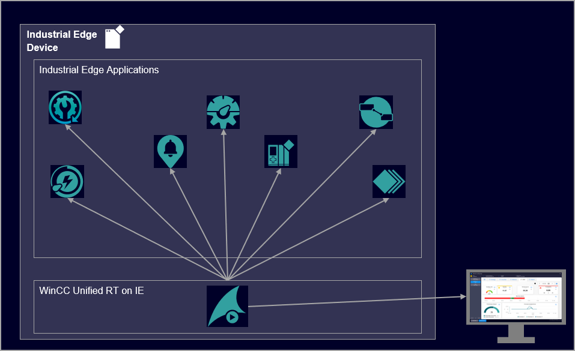
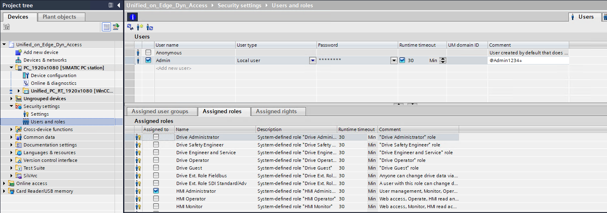
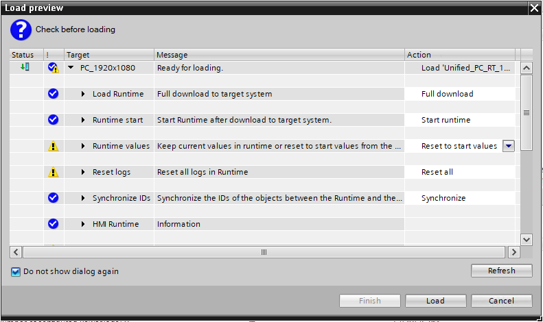
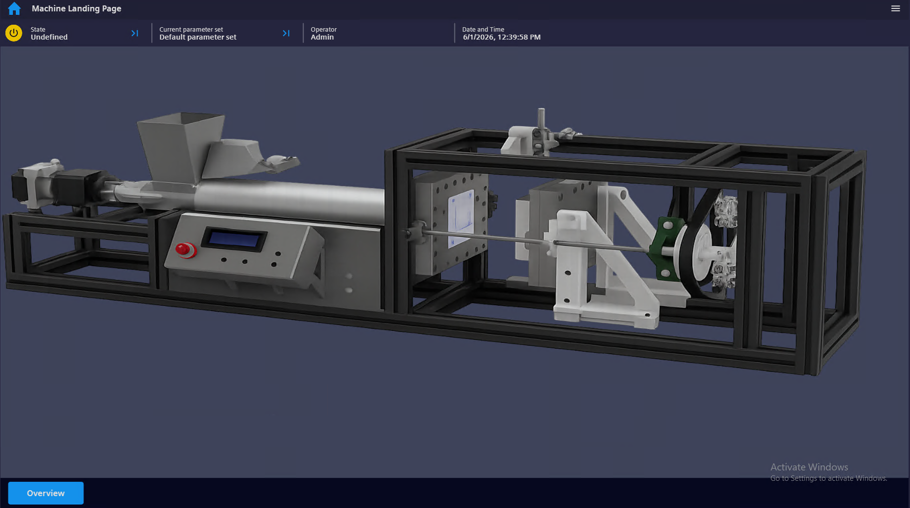

# machine-landing-page-for-wincc-unified-on-industrial-edge
The Machine Landing Page is an application example which shows how to dynamically access Edge Apps from inside the WinCC Unified Runtime
- [Machine Landing Page for WinCC Unified on IE](#writing-good-how-to-or-tutorial)
  - [Description](#description)
    - [Overview](#overview)
    - [General Task](#general-task)
  - [Requirements](#requirements)
    - [Prerequisites](#prerequisites)
    - [Used components](#used-components)
  - [Setup](#setup)
  - [Usage](#usage)
  - [Modifications](#modifications)
  - [How to integrate into an existing project](#how-to-integrate-into-an-existing-project)
  - [Documentation](#documentation)
  - [Contribution](#contribution)
  - [License and Legal Information](#license-and-legal-information)
    
## Description

### Overview

The "Machine Landing Page for WinCC Unified on IE" is an application example which shows how to dynamically access Edge Apps via API calls from inside the WinCC Unified Runtime.

By doing this the user can i.e. access dashboards of different Edge apps to get more information about what is currently happening on the machine without having to exit the Unified RT.  

### General Task

In order to get the most information about the machine a requirement our customers often have is not only to have an app which i.e. shows the maintenance cycles or energy consumption of a machine part but to also directly display the information in the machine UI to enable the operator to both control and supervise the machine at the same time.

The Machine Landing Page closes the gap between the machine UI (WinCC Unified RT) amd Industrial Edge Apps by providing a generic and easy-to-use TIA project based on the HMI Template Suite to display the information from the Industrial Edge Apps directly in the WinCC Unified Runtime. 
This is done via API calls which are triggered by a CWC from inside the Runtime and generally supports all Apps installed on the Edge Device.

For the most commonly used Edge Apps with dashboards a functionality is implemented to dynamically read out and access corresponding dashboards.

These apps are:
* Performance Insight
* Energy Manager
* Machine Monitor

The solution is meant to be a "one fits all" solution so it is very generic. 
The solution does not provide the configuration of Edge Apps and dashboards. These have to exist beforehand. 
You do not need to make any changes to the project when i.e. adding a new app. The configuration is done completely during RT.

## Requirements

### Prerequisites

* TIA Portal V21
* Industrial Edge Device (Physical or Virtual) with installed Unified RT on IE and Edge Apps
* Basic knowledge about TIA-Portal and WinCC Unified

### Used components

* IEVD ievd-1.26.2-1-b
* WinCC Unified RT on IE V 5.0.0
* Performance Insight V 1.24.0
* Energy Manager V 1.24.0
* Notifier V 1.24.0
* Machine Monitor V 3.0.2
* TIA Portal V21 Upd. 2

## Setup

In order to get the application running open the project archive in the TIA Portal. 
The project archive ("MachineLandingPage.zap21") can be found in the folder "src".

Before downloading the application to your device make sure to add a user with user role "HMI Administrator".
There is already a user available which can also be used (Name: "Admin").
The password for the user can be found in the "Comments" column.

Once you finished the user management you can download the application to your IED.
During download make sure to set the option "Runtime values" to "Reset to start values" as the users wont be available otherwise.

Once the project is downloaded you can access the RT from your browser.
Once logged in the following side is displayed:

## Usage

You can find further information about the following steps [here](docs/Usage.md).

- [Initial setup](docs/Usage.md#initial-setup)
- [Configuring apps and dashboards](docs/Usage.md#configuring-apps-and-dashboards)
    - [Standard apps](docs/Usage.md#standard-apps)
    - [Custom apps](docs/Usage.md#custom-apps)
    - [Overview of configured apps](docs/Usage.md#overview-of-configured-apps)
- [Accessing apps and dashboards](docs/Usage.md#accessing-apps-and-dashboards)

## Modifications

You can find further information about the following steps [here](docs/Modifications.md).

- [How to change the machine image](docs/Modifications.md#how-to-change-the-machine-image)
- [How to skip entering login credentials](docs/Modifications.md#how-to-skip-entering-login-credentials)
- [How to get configured apps/dashboards into the machine overview](docs/Modifications.md#how-to-get-configured-appsdashboards-into-the-machine-overview)
- [How to add new dashboard apps](docs/Modifications.md#how-to-add-new-dashboard-apps)
    - [General structure of an URL with dashboard](docs/Modifications.md#general-structure-of-an-URL-with-dashboard)
    - [What to change in the script](docs/Modifications.md#what-to-change-in-the-script)

## How to integrate into an existing project

You can find further information about the following steps [here](docs/Integration.md).

## Documentation

Add links to documentation. Either on external URL or in the doc folder. Please use always link to a file not to a directory (it doesn't work with static site generator engines).

Add these links:

You can find further documentation and help in the following links

* [Industrial Edge Hub](https://iehub.eu1.edge.siemens.cloud/#/documentation)
* [Industrial Edge Forum](https://forum.industrial-edge.siemens.cloud)
* [Industrial Edge Documentation](https://docs.industrial-operations-x.siemens.cloud/p/industrial-edge)
* [Industrial Edge landing page](https://new.siemens.com/global/en/products/automation/topic-areas/industrial-edge/simatic-edge.html)
* [Industrial Edge GitHub page](https://github.com/industrial-edge)
* [WinCC Unified Manual](https://docs.tia.siemens.cloud/p/simatic-wincc-unified)

## Contribution

Please check our [contribution guideline](CONTRIBUTING.md). 

## License and Legal Information

Please read the [Legal information](LICENSE.md).
