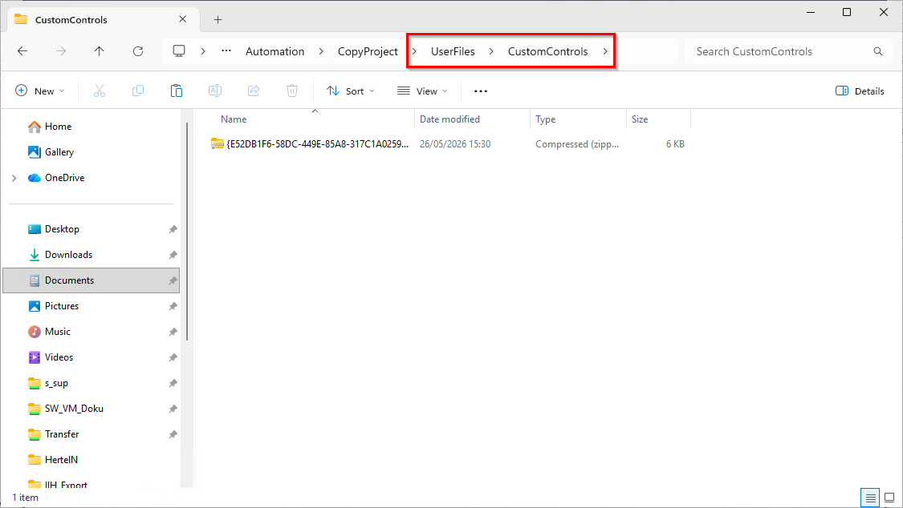
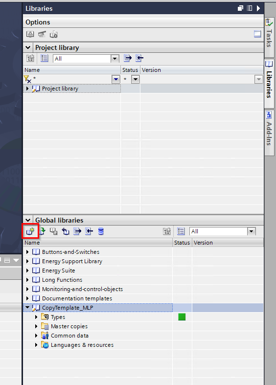
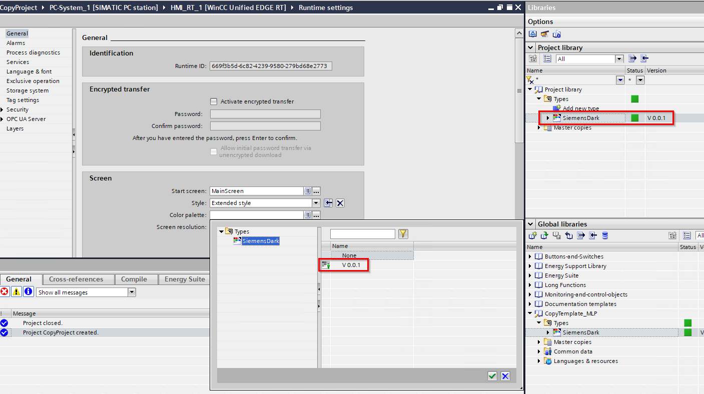
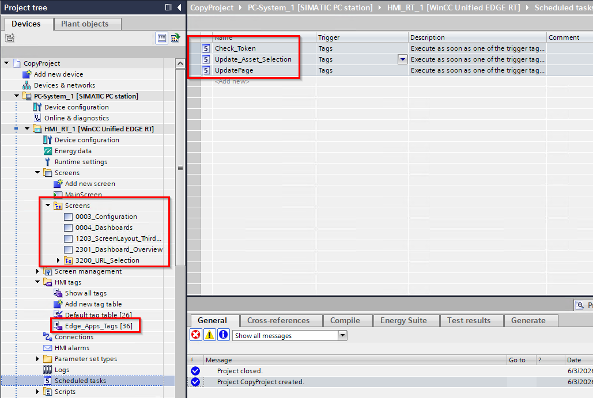
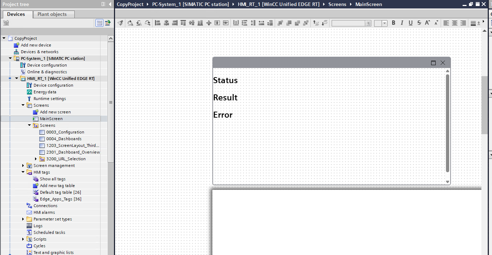
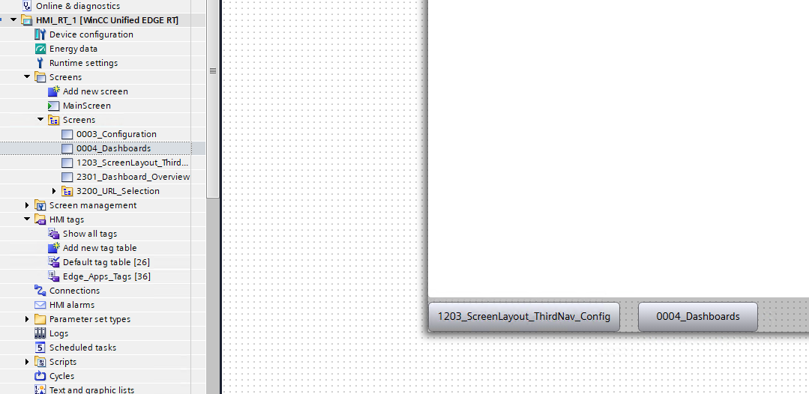

# How to integrate into an existing project

**NOTE:**
In order to use the example the CWC must be accessible all the time.
A project with navigation through screen window technique is thus mandatory.

If you want to integrate the functionality in an already existing project you can use the project library "CopyTemplate_MLP.zal21" as well as the separate CWC "RUN_API_CWC.zip" which can be found in the "CopyTemplate_MLP.zip" file. 
The "CopyTemplate_MLP.zip" file can be found in the "src" folder.

Procedure:

* Close your project (if opened in TIA-Portal), extract the CWC and copy the extracted .zip file into the following folder: 
[project folder]/UserFiles/CustomControls 
If the folder "CustomControls" does not exist yet, create it beforehand

* Extract the library and open it in your TIA project

* Copy the color palette from the global library into your project library
* Open the Runtime Settings and select the color palette "SiemensDark V 0.0.1"

* Copy the content from "Screens", "TagTable" and "tasks" from "Master copies" into your RT

* Open your main screen and copy the content from "CWC" into the screen. Place the CWC outside the visible area of the screen

* If you want to access the configuration screen use the screen "1203_ScreenLayout_ThirdNav_Config"
* If you want to access the display of the configured apps/dashboards use the screen "0004_Dashboards"

