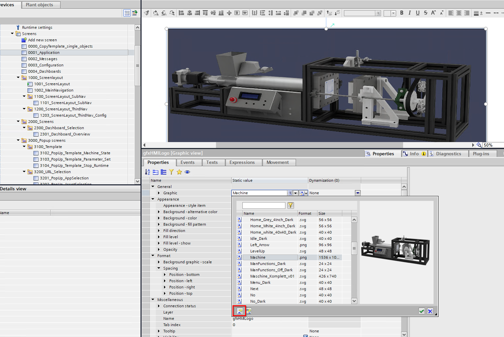
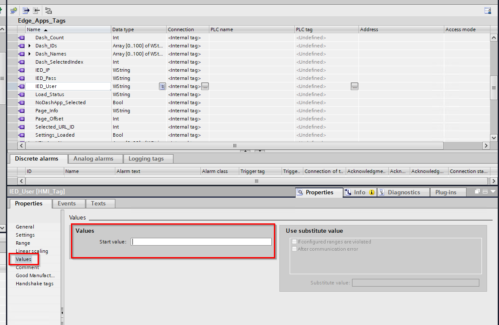
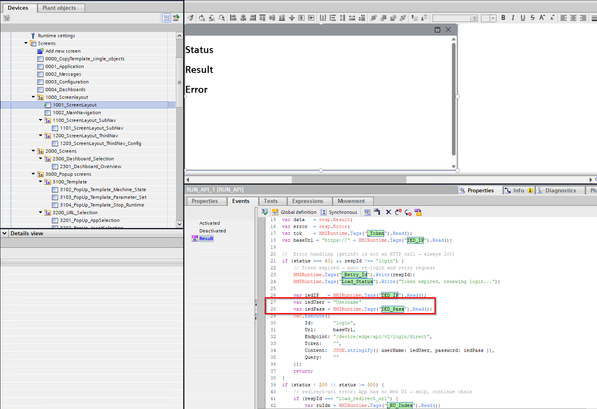
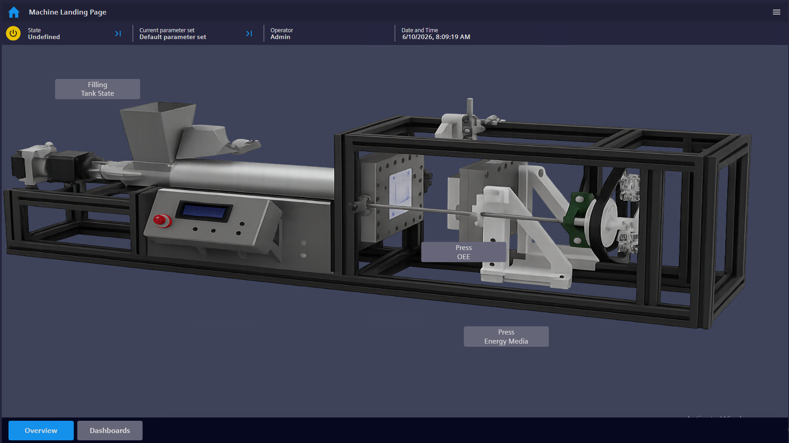
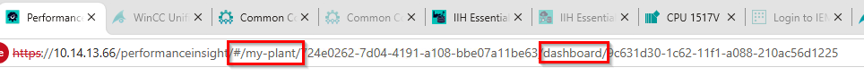
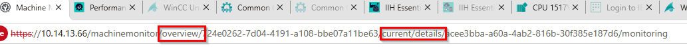
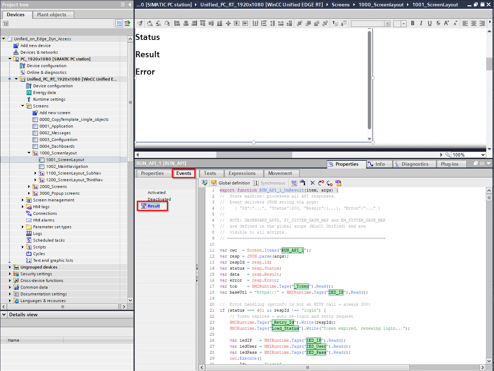
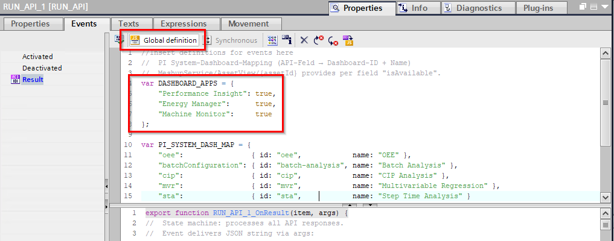
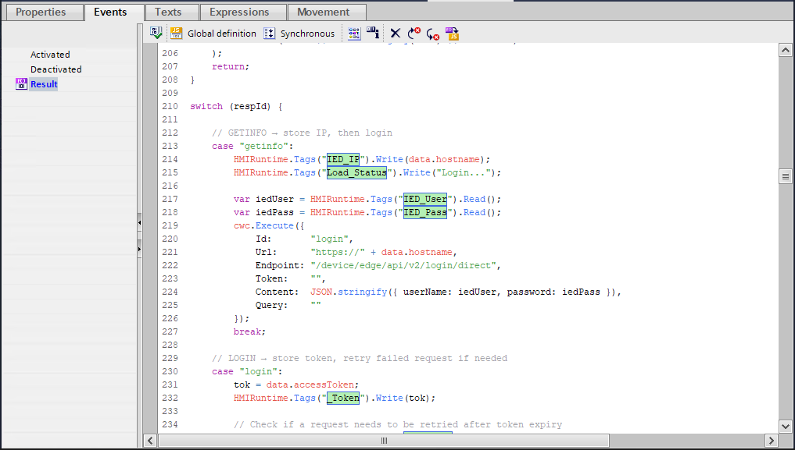

# Modifications
- [How to change the machine image](#how-to-change-the-machine-image)
- [How to skip entering login credentials](#how-to-skip-entering-login-credentials)
- [How to get configured apps/dashboards into the machine overview](#how-to-get-configured-appsdashboards-into-the-machine-overview)
- [How to add new dashboard apps](#how-to-add-new-dashboard-apps)
    - [General structure of an URL with dashboard](#general-structure-of-an-URL-with-dashboard)
    - [What to change in the script](#what-to-change-in-the-script)

### How to change the machine image

The example project also only uses a default machine image.

If you want to change the image so it fits your machine/usecase you can do that via the corresponding graphic view.

The graphic view can be found in the screen "0001_Application".
In order to change the displayed graphic select the object, click on "Graphic" and click on left button the bottom of the window to select a new graphic from your PC.

### How to skip entering login credentials

If you do not want the operator to always enter the credentials when logging in you can also use static values as login parameters in the project.

The credentials are stored in the following tags:

* IED_User = Username
* IED_Pass = Password

If you want these parameters to be static you have 2 options:

1. Give the tags a start value and remove the corresponding IO fields in the screen "0003_Configuration"
    
This has the benefit to still have a central way of changing the credentials when they i.e. have to be adjusted, however it takes 2 tags which can theoretically be removed
2. Remove the tags and use static text instead. 
   Procedure:
   * Open the screen "1001_ScreenLayout" and select the CWC "RUN_API_1"
   * In the event "Result" of the CWC you can find the script which does all API calls
   * Exchange the "Tags.Read()" calls in line 27, 28, 217 and 218 with the static credentials (iedUser = Username, iedPass = Password)
   
   * Open the screen "0003_Configuration" and select the button "txtButtonExecute"
   * In the event "Click left mouse button" you can find another script
   * Exchange the "Tags.Read()" calls in line 6 and 7 with the static credentials (iedUser = Username, iedPass = Password)

### How to get configured apps/dashboards into the machine overview

Currently there is a separate screen for displaying the configured dashboards.
This screen is "0004_Dashboards" which consists of (currently) up to 28 buttons and a HTML Browser control

If you wanted to move these buttons directly on your machine overview screen there are some changes to be made in the project.
Furthermore due to the workflow of the application example it then also becomes important to already know the configuration of the app/dashboard setup during the engineering phase.

**Background:**
Upon saving the configuration of an app/dashboard the information gets stored into some arrays during RT.

These tags are:

* URL_App_Names
* URL_Asset_Names
* URL_Dash_Names

These arrays are then used to further dynamize the objects during RT (i.e. the button texts, visibility etc. in screen "0004_Dashboards") and get filled in a way that there are no empty elements in between filled elements.

The configuration which is done during RT is set up as follows:

Config 1 = Arrays[0]
Config 2 = Arrays[1]
Config 3 = Arrays[2]
...

As this configuration is not visible in the engineering you thus need to know the exact configuration of the apps/dashboards to be able to move the correct button to the correct place in the overview.

In addition keep in mind that deleting one configuration after you have already placed the buttons in their correct position in the overview may affect the positions of the displayed buttons afterwards as well.

The following video shows the issue:

Once you know the configuration you can move the corresponding buttons to their dedicated positions in the machine image.

Keep in mind that you also still have to move the browser control to the screen with the machine image as well.

### How to add new dashboard apps

**NOTE:** 
**Adding new dashboard apps requires changing a lot in the scripts the project is using for fetching all needed data.** 
**As these scripts are pretty advanced an adaption of these scripts/workflows should only be done by somebody who is experienced in writing scripts.** 
**It is also recommended to have a look at the scripts and especially the script comments before changing them!**

Currently the projects checks 3 different apps for available dashboards:

These apps are:
* Performance Insight (PI)
* Energy Manager (EM)
* Machine Monitor (MM)

As not all apps are developed equally the procedure for accessing the dashboards of other apps may vary from the already implemented apps.

**Example:**
Both PI and EM provide a "dashboard service" which provides the dashboard IDs needed to create the URL and can be called via API, however the MM does not provide such a service so the final API calls differ a lot from the PI and EM way.
Other apps may have similar issues so you have to clarify beforehand which API calls are needed in order to get the information needed.

#### General structure of an URL with dashboard

The general structure the URL for accessing a dashboard of a Siemens app is as follows:

**`https://[IP address of IED]/[appname]/[app-specific part]/[asset ID]/[app-specific part]/[dashboard ID]`**

By default the project already reads out the IP of the IED, the app name and also the asset ID.

Depending on the app accessing the dashboard ID can vary from app to app.
In addition the app-specific URL parts should be analyzed beforehand (i.e. by accessing the dashboards directly on the IED and having a look at the URL in the browser)

**Example:**
For PI and EM the "app-specific parts" are "#/my-plant" and "dashboard".

For MM the "app-specific parts" are "overview" and "current/details".

Furthermore such apps typically also provide some predefined "System dashboards" like the "OEE" dashboard foe PI or the "Energy media" dashboard for EM.
You should also have a look at the URL of these dashboards as they may not have an ID but a default URL instead (i.e. for PIs OEE dashboard the URL always just shows "[...]/oee" and no dashboard ID).

#### What to change in the script

Once you found out the structure of your URL and found out the needed API calls to get the corresponding information you can integrate the new calls in the script workflow.

The main script can be found on the "Result" event of the CWC which is placed on the main screen.

At first add the name of your new dashboard app to the "Dashboard Apps"-array which can be found in the global definition area.

Depending on the app you may also need to add some array which lists all possible system dashboards (like it is done for EM and PI).

The main workflow of the script starts in line 210 of the script.

Depending on the response (respId) a new API call is triggered by the CWC (cwc.Execute) which is then further processed.
At the end of each call a new response is triggered which then calls the next steps and so on.

In order to integrate your API calls you can i.e. integrate them at the end of the switch case statement.