# Usage
- [Initial setup](#initial-setup)
- [Configuring apps and dashboards](#configuring-apps-and-dashboards)
    - [Standard apps](#standard-apps)
    - [Custom apps](#custom-apps)
    - [Overview of configured apps](#overview-of-configured-apps)
- [Accessing apps and dashboards](#accessing-apps-and-dashboards)

### Initial Setup 

Once the project is loaded you can start the configuration.

Therefore click on the burger menu on the upper right corner and select "Configuration".

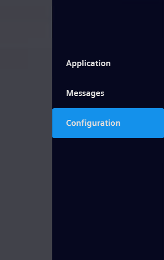

The configuration screen opens.

In the configuration screen you have to enter the credentials of your IED at first (User name + password).
Once you have filled out the credentials click on "Activate IED Settings".

The RT now fetches the data of all apps currently running on the IED as well as the IP address of the IED.
Once the process is finished the button gets highlighted in green and the button "START CONFIG" get usable.

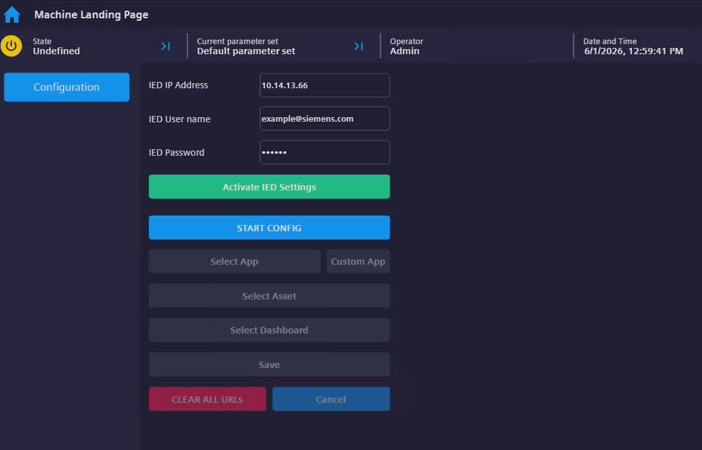

You are now able to start the configuration of the dashboards and apps you want to display in the Unified RT.

### Configuring apps and dashboards

In order to start the configuration of a new website/dashboard click on the "START CONFIG" button.
This will activate the "Select App" and "Custom App" button.

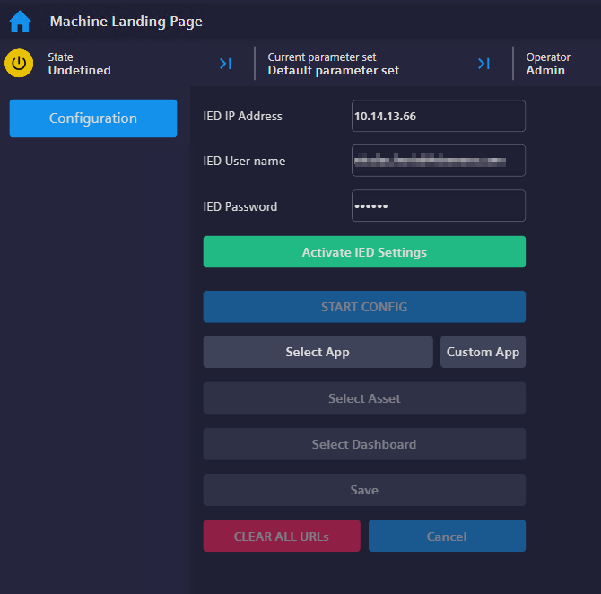

If you want to stop the configuration you can always (during each step) click the "Cancel" button.

#### Standard apps

When clicking the "Select App" button a PopUp will open and show you all Apps which are currently installed on the IED.

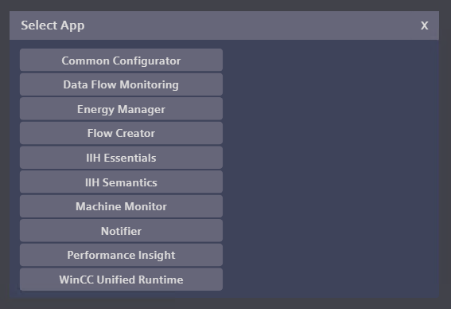

Upon selecting an App from the list your selected entry will be displayed instead of "Select App" and the button gets highlighted in green.

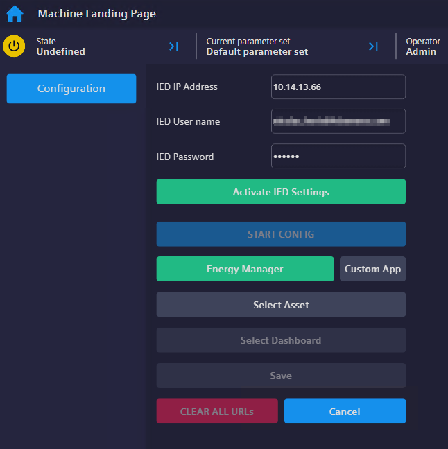

If you want to select another app instead you can click on the green button again and select another app instead.

The configuration differs between apps with and without dashboards.

Apps with dashboards are:
* Performance Insight
* Energy Manager
* Machine Monitor

If you select another app than the apps listed above you are finished with the configuration.
The button "Save" gets enabled and you can save your configuration.

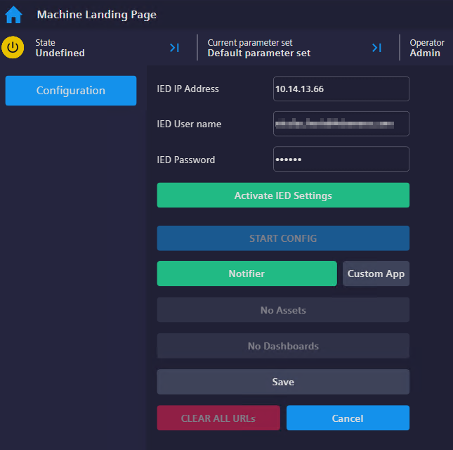

If you select one of the above mentioned apps the button "Select Asset" gets enabled.
Clicking on the button will show you all assets which have dashboards in the selected app.

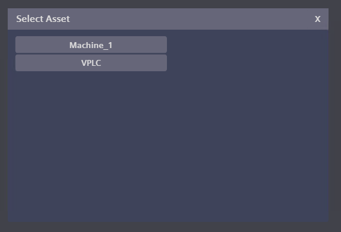

Upon selecting an asset from the list your selected entry will be displayed instead of "Select Asset" and the button gets highlighted in green.

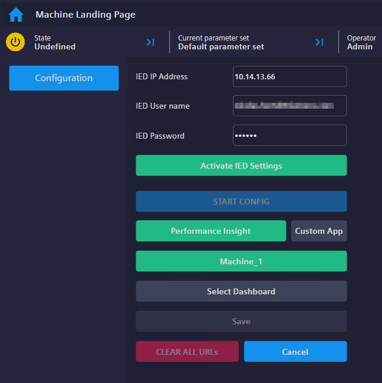

If you want to select another asset instead you can click on the green button again and select another asset instead.

Once you have selected your asset the button "Select Dashboard" gets enabled.
Clicking on the button will show you all dashboards available for the selected asset.

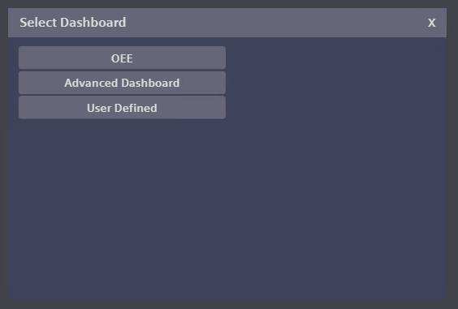

Upon selecting a dashboard from the list your selected entry will be displayed instead of "Select Dashboard" and the button gets highlighted in green.

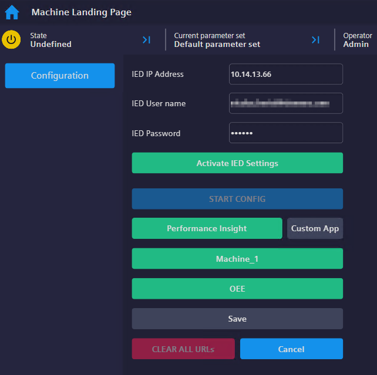

If you want to select another dashboard instead you can click on the green button again and select another dashboard instead.

Once you have selected the dashboard you are finished with the configuration.
The button "Save" gets enabled and you can save your configuration.

#### Custom apps

In case your desired app is not displayed in the app list (this i.e. can happen when using non-Siemens apps or other custom made apps) you can also use the button "Custom App" to enter the URL of a custom app.

Once selecting "Custom App" 2 Input fields "Custom App Name" and "Custom URL" are displayed.
You can now enter the information of your custom app to access the app from Unified as well:

* Custom App Name: Name of the App. WinCC Unified will use this name for displaying the app as well
* Custom URL: URL WinCC Unified will access when clicking on the corresponding button

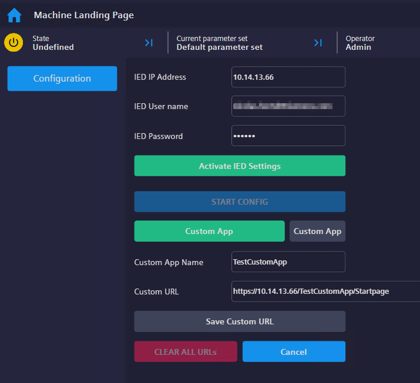

Once you are finished entering the name and the URL of the custom app the "Save" button gets enabled and you van save the configuration.

#### Overview of configured apps

When clicking the "Save" button a new entry will appear on the left side of the configuration screen for each new finished configuration.

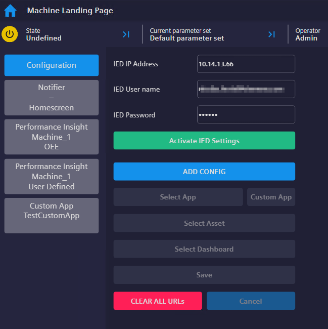

Once one configuration is finished the "CLEAR ALL URLs" button is enabled.
When clicking on the button a confirmation popup will be shown.
Clicking "YES" in this popup will delete the complete configuration.

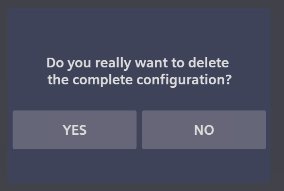

When selecting a configuration on the left side you can see more details of the configured app/dashboard:

* Application Name: Name of the displayed application
* Asset Name: Name of the displayed asset. This shows "-" when an app without dashboard is selected and stores the value of "Custom App Name" when "Custom App" was selected during configuration
* Dashboard Name: Name of the displayed dashboard. This shows "Homescreen" when an app without dashboard is selected and is empty when "Custom App" was selected during configuration
* URL: Full URL which is called by the browser control

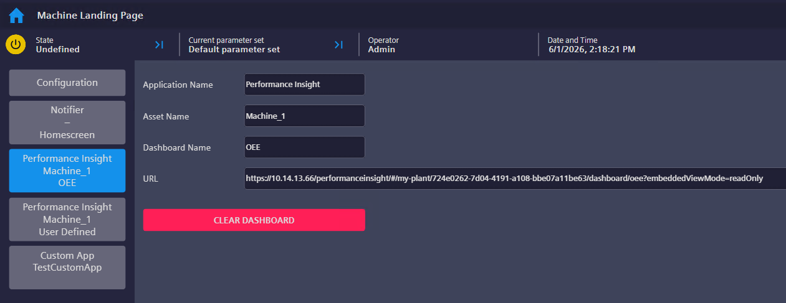

Furthermore you also have the possibility to delete the single configuration in this overview by clicking the "CLEAR DASHBOARD" button and then clicking "YES" on the confirmation popup afterwards.

Clicking on the button "Configuration" will open the configuration screen again.

### Accessing apps and dashboards

Once you are finished with the configuration you can access the configured apps/dashboards.

Therefore go back to the start screen.
This can either be done by clicking on the "Home" button in the upper left corner or via the burger menu.

Once you are back in the main screen you can click on the button "Dashboards" to open the overview of all configured dashboards.

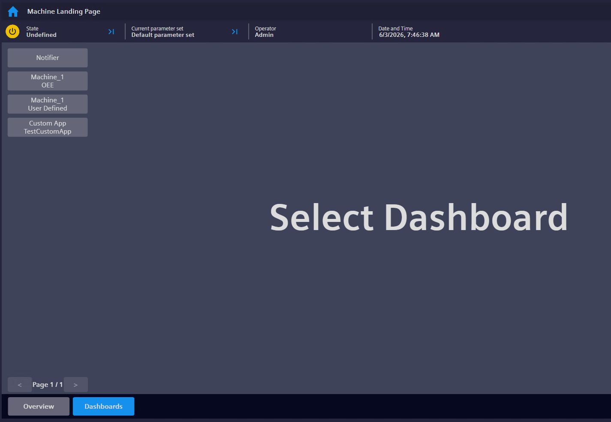

When clicking on one of the buttons on the left side you can switch between the configured apps/dashboards.
If you created more than 14 dashboards the navigation buttons on the lower left side get active.

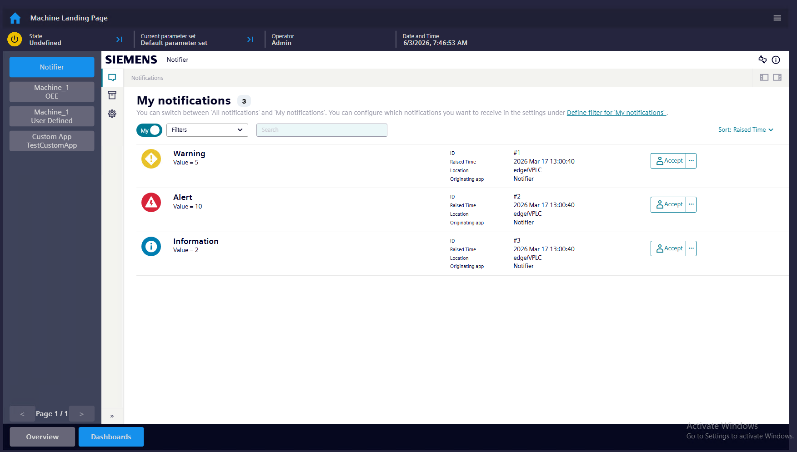